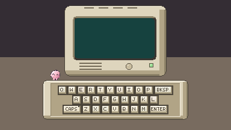

# Jump Keys

*A little guy. A giant keyboard. 30 seconds to get it right.*

Jump Keys is a pixel-art platforming game where you control a tiny buddy navigating a giant keyboard. Your objective is to type randomly generated passwords by physically jumping onto keyboard keys, all while racing against the clock.

Originally prototyped as **Little Guy**, the game was created around the game jam theme *"I'm just a little guy."*



## 🎮 How to Play

Each round presents you with a randomly generated five-character password.

Move your buddy across the keyboard, stepping on the right keys to enter the password. Get it right before the timer runs out to earn points and move on to the next challenge.

Be careful: an incorrect submission or running out of time ends your run!

## ✨ Features

- **Keyboard Platforming:** Explore a giant keyboard as a tiny character using WASD movement.
- **Jump & Double Jump:** Navigate between keys using a two-stage jumping mechanic.
- **Physical Key Interactions:** Step onto individual keycaps to register characters.
- **Random Password Generation:** Every round generates a new five-character password.
- **Race Against Time:** Complete each password within 30 seconds.
- **Caps Lock:** Toggle between uppercase and lowercase characters.
- **Backspace & Enter:** Correct your input and submit your password.
- **Scoring System:** Earn 100 points for every correctly entered password.
- **Persistent High Scores:** Your highest score is saved between sessions.

## 🕹️ Controls

| Key | Action |
|---|---|
| W / A / S / D | Move |
| Space | Jump / Double Jump |
| Caps Lock | Toggle uppercase / lowercase |
| Backspace | Delete last character |
| Enter | Submit password |

**Note:** Keyboard keys only register when the buddy is grounded.

## 🚀 Getting Started

### Requirements

- Unity **6000.3.10f1**
- Unity Hub

### Run the Project

1. Clone the repository:

   ```bash
   git clone https://github.com/BlueLotus-fire/jumpkeys.git
   ```

2. Open Unity Hub.
3. Select **Add Project from Disk**.
4. Choose the cloned `jumpkeys` folder.
5. Open the project using Unity 6000.3.10f1.
6. Open `Assets/Scenes/MAINMENU.unity` and press Play.

## 🛠️ Built With

- **Unity 6** – Game engine
- **C#** – Gameplay programming
- **Unity Input System** – Keyboard input handling
- **Unity 2D / URP** – 2D rendering and physics
- **TextMesh Pro** – UI and text rendering
- **Aseprite** – Pixel-art creation

## ⚙️ How It Works

Jump Keys combines character movement, collision-based interactions and a password validation system to turn a familiar keyboard into a playable environment.

Each keycap has its own `Keycap` component. When the buddy enters a key's trigger while grounded, the keycap animates its pressed state and passes its corresponding character to the `MonitorController`.

The `MonitorController` manages password generation, typed input, Caps Lock state, the countdown timer and scoring. Correct submissions generate a new password, while incorrect submissions or timeouts trigger the end-game sequence.

The buddy's movement is handled through `Rigidbody2D`, while the jumping arc is animated through the character sprite's local position. This allows the game to distinguish between grounded and airborne key interactions.

High scores are stored locally using Unity's `PlayerPrefs`.

## 📁 Project Structure

```text
jumpkeys/
├── Assets/
│   ├── Scenes/
│   │   ├── MAINMENU.unity
│   │   ├── GAMEPLAY.unity
│   │   └── ENDSCREEN.unity
│   ├── Scripts/
│   │   ├── BuddyController.cs
│   │   ├── Keycap.cs
│   │   ├── MonitorController.cs
│   │   ├── CapsLock.cs
│   │   ├── MainMenuController.cs
│   │   └── EndGameController.cs
│   ├── Sprites/
│   ├── Fonts/
│   └── nuke.mp4
├── Packages/
├── ProjectSettings/
└── README.md
```

## 🙌 Credits

Created during a game jam around the theme **"I'm just a little guy."**

Original prototype name: **Little Guy**

---

*Can you top a nuke?* ☢️
